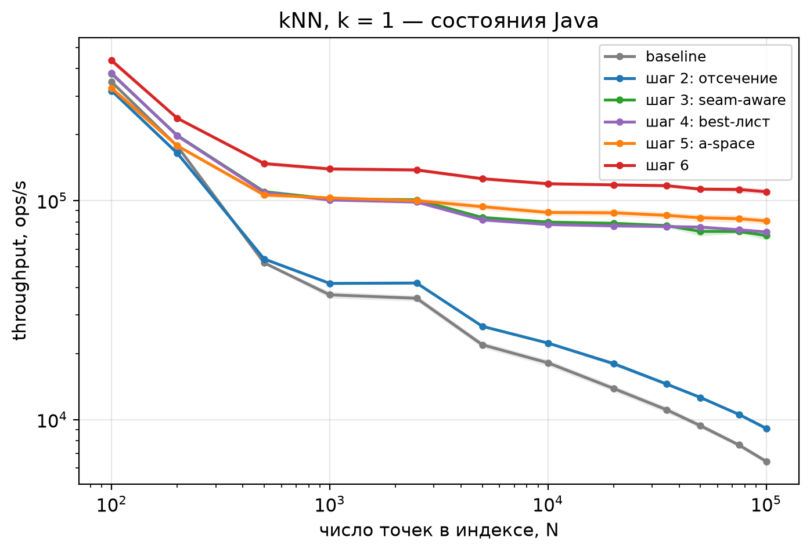
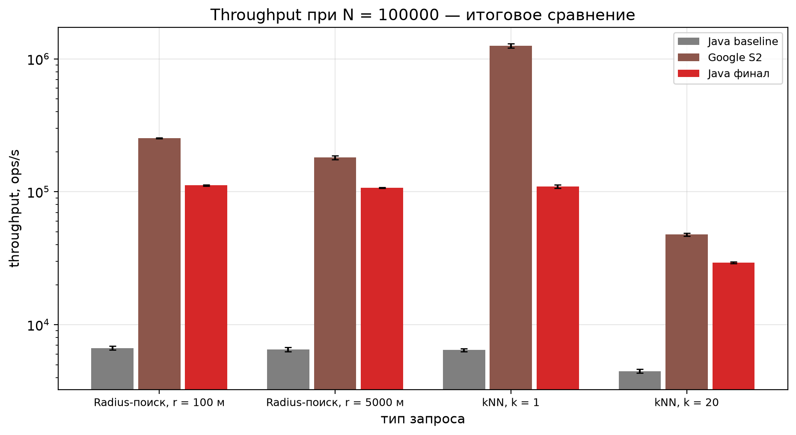
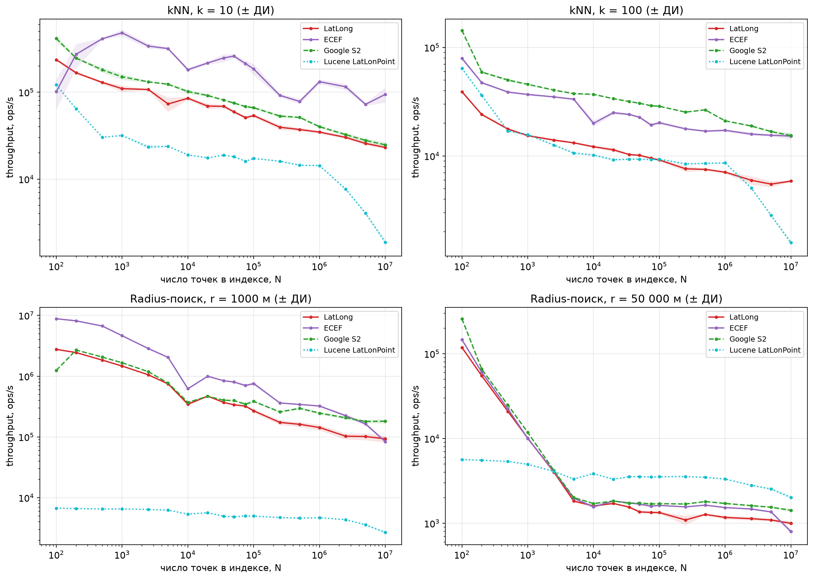

# Отчёт по лабораторной работе: Geo KD-tree — профилирование и оптимизация

## Задание

Реализовать один из изученных на предыдущих курсах алгоритмов или структур данных и выполнить анализ производительности полученного решения, а также серию оптимизаций алгоритма с точки зрения потребления памяти, ресурсов процессора и jit-а.

## Цель

Взять прямой порт C#-реализации KD-tree для геоточек и довести её до производительности, сопоставимой с промышленными библиотеками, с доказательством каждого шага замерами и профилями.

## Обозначения

- **LatLong** — реализация, работающая непосредственно в координатах широта/долгота (порт C# с оптимизациями шагов 2–6); историческая ветвь экспериментов.
- **ECEF** (Earth-Centered, Earth-Fixed) — действующая реализация: точки хранятся в землецентрических декартовых координатах.
- $R = 6\,371\,000$ м — радиус Земли (сферическая модель, гаверсинусовая метрика).
- $\varphi$ — широта, $\lambda$ — долгота (в радианах, если не указано иное); $\Delta\varphi$, $\Delta\lambda$ — разности между точкой запроса и узлом дерева.
- Единица замеров — операций поиска в секунду (ops/s); все графики построены с 95%-доверительным интервалом.

## Что сделано

1. Выполнен полный цикл оптимизаций: шесть итераций над LatLong-реализацией, затем переход к ECEF; каждое состояние сохранено коммитом с замерами и профилями.
2. Построен стенд сравнения: собственная реализация против Google S2, Apache Lucene и статического Smile; реальные данные (NYC Taxi до 8 млн точек, OSM POI), C#-версия с выровненным конфигом, сетка до 10 млн точек на кластерных данных.
3. Методика доведена до уровня, где цифрам можно верить: уникальные данные, запросы внутри кластеров без самопопаданий, доверительные интервалы на всех графиках, многопрогонные сверки спорных случаев. По пути найдено и исправлено три собственных бага измерения (дубликаты генератора, кучкование запросов, вырождение LatLong-реализации на отсортированной загрузке).

## Результаты цикла оптимизаций

### Первая фаза: шесть состояний LatLong-реализации

Каждый шаг: что не устраивало, какая идея исправляет, эффект. Базовые значения — throughput, ops/s, N = 100000.

| Шаг | Идея | radius r=100 | kNN k=1 | kNN k=20 |
|---|---|---|---|---|
| baseline (порт C#) | исходный код: расстояние считается для каждой проверяемой точки | 6 678 | 6 447 | 4 475 |
| 2. отсечение по долготе | ветвь за меридианом-сепаратором пропускается, если нижняя граница расстояния до неё больше радиуса | 7 653 | 9 120 | 6 032 |
| 3. граница у шва карты | та же идея, но расстояние считается до ближайшего ребра дуги: меридиана или линии смены дат (+180°/−180° соседствуют) | 47 120 | 69 253 | 19 310 |
| 4. упорядоченный список кандидатов | список лучших k держится отсортированным, новый кандидат вставляется бинарным поиском вместо повторной сортировки | 49 185 | 71 938 | 25 294 |
| 5. сравнение без извлечения корня | порядок точек по расстоянию совпадает с порядком по величине $\sin^2(d/2R)$: сравнения без квадратного корня и обратного синуса; метры — только для выдачи | 71 079 | 80 771 | 25 877 |
| 6. предварительное вычисление косинусов при вставке | косинус широты узла хранится в узле, запроса — считается один раз на запрос: в обходе остаются два синуса вместо двух синусов и двух косинусов | 111 643 | 109 758 | 29 336 |

**Метрика baseline.** Расстояние по гаверсинусовой формуле:

$$a = \sin^2\frac{\Delta\varphi}{2} + \cos\varphi_1\cos\varphi_2\cdot\sin^2\frac{\Delta\lambda}{2}, \qquad d = 2R\cdot\arcsin\sqrt{a}$$

В исходном коде величина $d$ вычислялась целиком для каждой точки листа и каждой проверки ветви. Профиль показал ~94% CPU в `Math.asin` (реализация fdlibm): полиномиальная аппроксимация обратного синуса — самая дорогая часть формулы, и она выполняется чаще всего. Вывод, определивший весь цикл: ускорять не формулу, а число её вызовов, то есть отсекать дерево раньше, чем расстояние понадобится.

**Шаг 2 — отсечение по долготе.** KD-tree разделяет точки плоскостью (меридианом или параллелью); до ближайшей точки «альтернативной» ветви есть аналитическая нижняя граница. Для широтного сплита расстояние до границы равно дуге по меридиану, и её член $a$ выражается без тригонометрии запроса:

$$a_{\text{bound}} = \sin^2\frac{\Delta\varphi}{2}, \qquad \Delta\varphi = |\varphi_{\text{split}} - \varphi_q|$$

Если $a_{\text{bound}} > a_r$ (член $a$ для радиуса запроса), ветвь заведомо пуста и не обходится. Для долготного сплита аналогичная граница — $R\cdot\arcsin(|\cos\varphi_q|\cdot\sin s)$, где $s$ — угловое расстояние до меридиана-сепаратора; в $a$-форме: $a_{\text{bound}} = \bigl(1-\sqrt{1-x^2}\bigr)/2$ при $x = |\cos\varphi_q|\cdot\sin s$ — по-прежнему без обратного синуса. Оговорка: на линии смены дат значения долгот разрывны, и простая граница по $\Delta\lambda$ ошибочно отсекает близкие точки — без запрета отсечения у шва property-тесты ловят пропуски. Эффект шага: +20–26%.

**Шаг 3 — граница у шва карты.** Оговорка шага 2 заменена на точную геометрию: для долготного сплита расстояние считается до ближайшего ребра дуги, где $s = \min(\Delta\lambda,\ 360^\circ-\Delta\lambda)$ — то есть линия смены дат рассматривается как второй кандидат-сепаратор. Отсечение становится корректным на всём диапазоне долгот, запрет снят, и именно здесь появляется основной скачок: ×3.5–5.1 к предыдущему состоянию.

**Шаг 4 — упорядоченный список кандидатов.** В kNN-поиске список лучших $k$ при каждом новом кандидате пересортировывался целиком ($O(k\log k)$ на принятие). Замена: список постоянно держится отсортированным по убыванию расстояния, худший кандидат — первым; новый элемент вставляется позицией, найденной бинарным поиском ($O(\log k)$), с удалением бывшего худшего. Эффект: +38% в k=20, в radius и k=1 без изменений.

**Шаг 5 — сравнения без извлечения корня.** Функция $d = 2R\cdot\arcsin\sqrt{a}$ строго монотонна по $a$, поэтому порядок точек по расстоянию совпадает с порядком по величине $a$. Обход и отсечение сравнивают $a$ кандидата с порогом $a_r = \sin^2(r/2R)$ (один синус на запрос) и с худшим элементом списка, не вычисляя ни $\sqrt{}$, ни $\arcsin$; метры достраиваются только для попаданий и принятых кандидатов. Кандидат, чей $a$ попадает в полосу 8 ulp от порога, решается точным пересчётом в метры с тай-брейком по идентификатору точки — это снимает неоднозначность округления на границе радиуса. Эффект: ×1.4–1.5 к шагу 4.

**Шаг 6 — предварительное вычисление косинусов при вставке.** Член $\cos\varphi_1\cos\varphi_2$ зависит от широты узла, которая зафиксирована с момента вставки: $\cos\varphi_{\text{node}}$ хранится в узле, $\cos\varphi_q$ вычисляется один раз на запрос. В обходе на узел остаются два синуса полуразностей ($\sin(\Delta\varphi/2)$, $\sin(\Delta\lambda/2)$) вместо двух синусов и двух косинусов. Заметим, что и синус полуразности раскладывается по точкам: $\sin\frac{\varphi_q-\varphi_n}{2} = \sin\frac{\varphi_q}{2}\cos\frac{\varphi_n}{2} - \cos\frac{\varphi_q}{2}\sin\frac{\varphi_n}{2}$, то есть возможно и полное предвычисление обоих членов; эта линия не опробована, поскольку следующий шаг (ECEF) убрал тригонометрию из обхода целиком. Принятый вариант — вместо замены обратного синуса на арктангенс: эксперимент $\arcsin \to \mathrm{atan2}$ дал −5…−12% (арктангенс на этой JVM сводится к тому же библиотечному коду, но полином длиннее), отклонён и сохранён с цифрами. Эффект шага: ×1.6–1.7.

Итог фазы: ×16.4–17.0 к baseline для radius и k=1, ×6.6 для k=20; преимущество растёт с размером данных.

Финал выходит на плато и не замечает роста дерева; baseline деградирует. На N=100000 индекс быстрее полного перебора в 570–1075 раз.

### Вторая фаза: переход к ECEF и последующие улучшения

LatLong-узел после шага 6 всё ещё тратит десятки наносекунд на два синуса на точку. Три следующих изменения (замеры на обновлённой сетке, см. сравнение с библиотеками ниже):

**1. Переход к землецентрическим координатам (ECEF).** Точки переводятся в декартовы координаты на сфере:

$$X = R\cos\varphi\cos\lambda, \qquad Y = R\cos\varphi\sin\lambda, \qquad Z = R\sin\varphi$$

Конверсия выполняется один раз при вставке. Метрика в обходе — квадрат хорды:

$$h^2 = \Delta X^2 + \Delta Y^2 + \Delta Z^2 \quad\text{— три вычитания, три умножения, два сложения на точку}$$

Хорда монотонна по дуге ($h = 2R\sin(d/2R)$), поэтому порог радиуса переводится один раз на запрос, $h_r^2 = \bigl(2R\sin(r/2R)\bigr)^2$, и сравнения идут по $h^2$ без корня. Границы отсечения строятся из полупространств: широтный сплит — это плоскость $Z = R\sin\varphi_0$ (расстояние до неё — одно вычитание), долготный — двугранный клин через ось $Z$ (две линейные формы), а линия смены дат учитывается второй гранью клина точно, без оговорок. Тригонометрия остаётся только для выдачи результатов в метрах ($d = 2R\cdot\arcsin(h/2R)$ на попадание). Эффект против шага 6: ×2.1–2.9 на сетке, ×2.3–4.2 в многопрогонной сверке (5 fork'ов).

**2. Примитивный буфер кандидатов.** Объектный список лучших $k$ с компаратором заменён на массив примитивов (квадраты хорд и индексы) с перезаписью худшего слота и линейным сканом $O(k)$: сортировок и аллокаций на кандидата нет. Принят после сравнения вариантов: сортированный массив с бинарной вставкой проиграл (двойная перестановка на принятом кандидате давала регресс k=20 на 25%). Эффект: k=20 в 1.2 раза быстрее объектного списка; в многопрогонной сверке k=1 в 2.8 раза быстрее LatLong-реализации.

**3. Балансировка при вставке (scapegoat).** При нарушении баланса — доля потомка больше $\alpha = 0.7$ от размера поддерева — поддерево перестраивается медианами по очередной оси, амортизируя стоимость вставки. Устраняет единственный известный слом структуры: на отсортированной загрузке дерево без балансировки вырождалось в ленту (в 6.9–11 раз больше посещённых узлов на запрос; LatLong-версия в полном прогоне исчерпывает стек уже на 5000 точек). С балансировкой sorted- и перемешанная загрузка не различаются (отношение 0.98), на кластерных данных k=20 ускорился ещё на 30%.

## Сравнение с публичными библиотеками

Единая сетка до 10 млн точек на реалистичных кластерных данных («города»: 5000 точек в кластере, разброс 33 км; запросы внутри кластера; ~3 попадания при r=1 км, ~2700 при r=50 км):

| Семейство | N | LatLong | ECEF | S2 | Lucene |
|---|---|---|---|---|---|
| kNN k=10 | 100 тыс. | 53 837 | **185 270** | 66 334 | 17 295 |
| kNN k=10 | 10 млн | 23 168 | **94 514** | 24 797 | 1 876 |
| kNN k=100 | 100 тыс. | 9 176 | 20 225 | **28 696** | 9 343 |
| radius r=1 км | 100 тыс. | 268 766 | **756 108** | 385 123 | 4 987 |
| radius r=1 км | 10 млн | 93 230 | 83 796 | **181 498** | 2 686 |
| radius r=50 км | 100 тыс. | 1 338 | 1 626 | 1 704 | **3 538** |

Итог по семействам: ECEF-реализация впереди в k=10 на всей сетке (×2.5–3.8 к S2) и в городском radius до миллиона точек. S2 выигрывает большие $k$ и плотные режимы на 10 млн — там доминирует не цена узла, а объём выдачи, где у S2 конвейер клеточного покрытия эффективнее. Lucene силён только в плотной выдаче (его конвейер документов), в kNN он на порядок позади. Статический Smile из сравнения исключён как другой класс: на равномерных данных он быстрее всех (пакетная сборка даёт в ~8 раз меньше посещённых узлов), цена — отсутствие одиночных вставок; плата за мутабельность на реальных данных составляет 1.3–2 раза в пользу нашей реализации.

На реальных данных (NYC Taxi, 1.5 и 8 млн посадок; OSM POI по NYC) ECEF-реализация лидирует среди мутабельных библиотек в radius и k=20: на 8 млн точек k=20 — 79 мкс против 166 у Smile, radius r=100 — 38.4 против 59.3; S2 на кластерах деградирует на клеточном скане до ×140.

## Профайлинг

Профили сняты tight-loop прогоном (без JMH-ожиданий) и отрендерены async-profiler; параметры: n=100000, 30 с.

**Baseline, radius-поиск.** Почти всё дерево — одна функция:

~94% CPU в `Math.asin` (fdlibm). Вывод, определивший весь цикл: ускорять не формулу расстояния, а число её вызовов — то есть отсекать дерево.

**Финал, radius-поиск.** Картина принципиально другая:

Обход ECEF (квадрат хорды + полупространственные границы) — 52% CPU, остаток — `asin` и `sqrt` на точных метрах попаданий (41%): это цена выдачи результата в метрах, а не поиска; она неустранима без смены контракта выдачи. В kNN LatLong-версии заметную долю занимало обслуживание списка кандидатов; переход на примитивный буфер снял её (k=20 к списку-объектам ×1.2, в многопрогонной сверке k=1 к LatLong ×2.8).

Интерактивные flamegraph по каждому состоянию: `report/profiles/grid/*.html`.

## Корректность

84+ теста на каждом состоянии, включая property-тесты оптимизированного поиска против эталонного полного перебора по гаверсинусу (допуск $10^{-6}$ м на расстояние и совпадение множеств точек). Обе замены метрики на монотонный прокси ($a$-пространство в LatLong, $h^2$ в ECEF) покрыты тестами с учётом пограничной полосы 8 ulp: кандидат в полосе решается точной метрикой с тай-брейком по идентификатору, что делает выдачу детерминированной. Отдельные тесты — шов ±180°, полюса, отсортированная загрузка (глубина дерева, оракул выдачи). Сверка выдач со Smile: 0 расхождений в 1200 случаях, расхождение расстояний ≤ $1.7\cdot10^{-13}$ м (разные порядки операций у гаверсинуса и хорды).

## Выводы

1. Геодезическая тригонометрия в узле стоила ×3–5 производительности; переход на вычисления в землецентрических координатах закрыл этот резерв — цена узла (3 вычитания, 3 умножения, 2 сложения на точку) стала сопоставима со статическими структурами.
2. Разрыв со статическими библиотеками — структура обхода, а не метрика: пакетная сборка даёт более плотные границы. Попытка перенести ограничивающие коробки в нашу топологию опровергнута замером с механизмом (коробка в ECEF над градусным сплитом рыхлее точных полупространств), поэтому разрыв целесообразно закрывать не структурой, а ценой узла.
3. В классе «мутабельный сферический индекс» реализация в ~350 строк без зависимостей конкурентна производственной библиотеке Google: лидерство в k=10 на всей сетке до 10 млн, паритет или лидерство в городском radius до миллиона точек; уступка — большие $k$ и плотные режимы на 10 млн.
4. Методика — часть результата: одиночные прогоны недооценивали короткие циклы до ×2, а три бага выборки данных и запросов искажали картину сильнее, чем любая разница реализаций.

## Артефакты

- Сырые замеры: `report/bench/grid/` (сетки по состояниям, ECEF, Smile, S2, Lucene, реальные данные, 10 млн)
- Графики: `report/charts/` (генераторы `tools/make_charts.py`, `tools/make_ecef_charts.py`)
- Профили: `report/profiles/grid/` (JFR + flamegraph по каждому состоянию)
- Код: `src/main/java/org/timermakov/geo/` (действующая реализация ECEF, LatLong сохранена для экспериментов)
