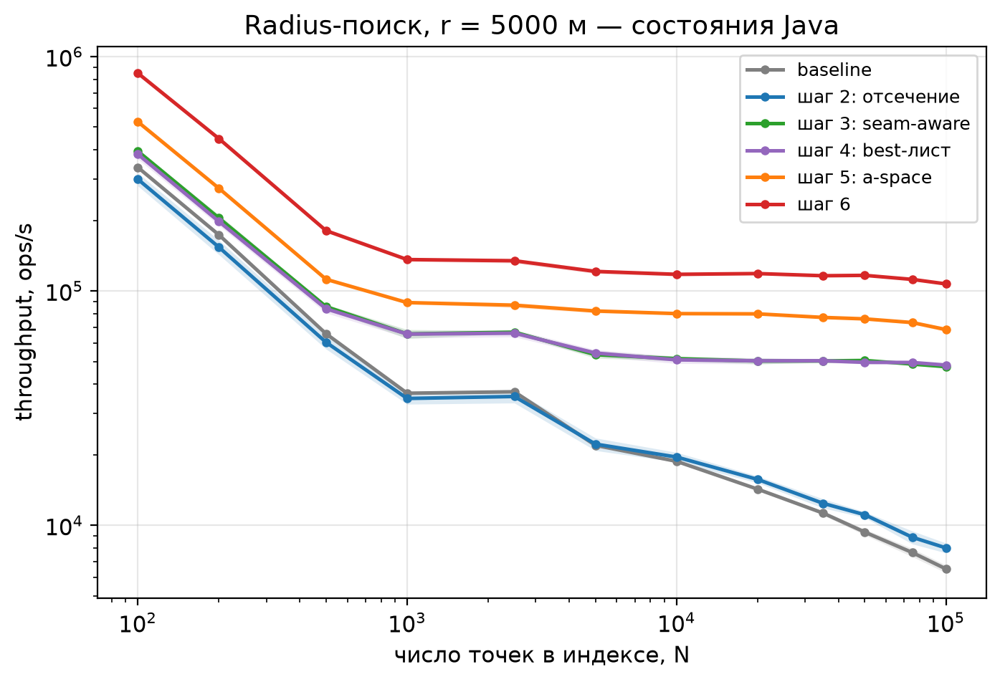
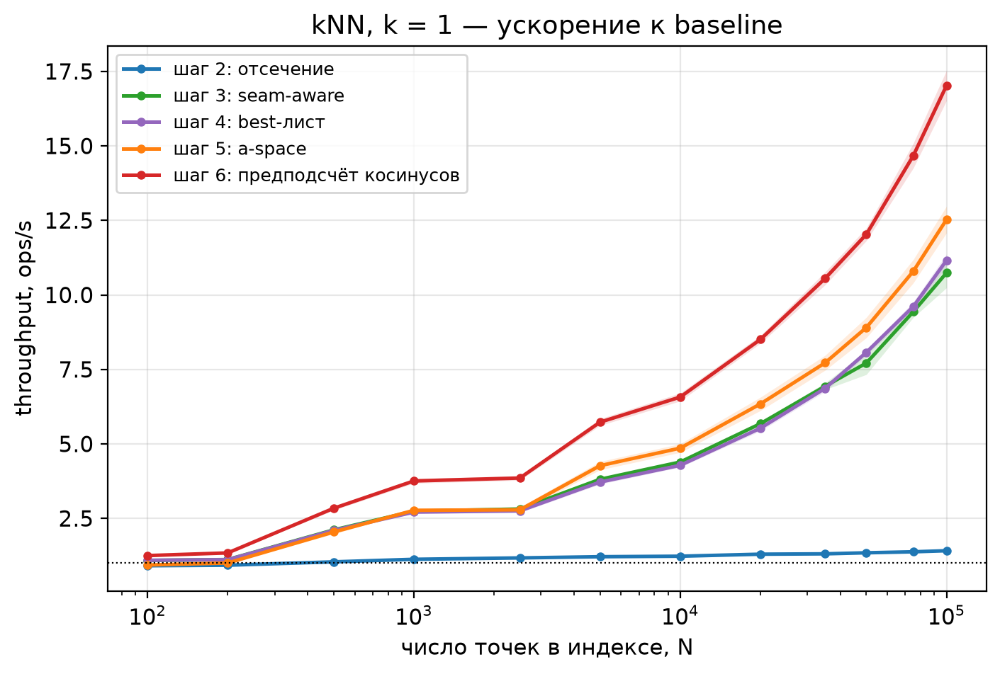
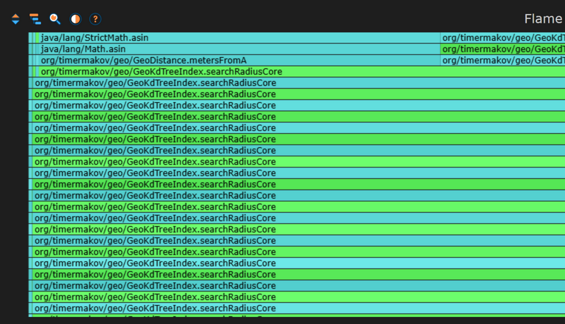

# Отчёт по лабораторной работе: Geo KD-tree — профилирование и оптимизация

## Задание

Реализовать один из изученных на предыдущих курсах алгоритмов или структур данных и выполнить анализ производительности полученного решения, а также серию оптимизаций алгоритма с точки зрения потребления памяти, ресурсов процессора и jit-а.

## Цель

Взять прямой порт C#-реализации KD-tree для геоточек и довести его до производительности, сопоставимой с промышленными библиотеками, с доказательством каждого шага замерами и профилями.

## Что сделано

1. Выполнен полный цикл оптимизаций: шесть итераций с сохранёнными артефактами.
2. Построен стенд сравнения: собственная реализация против Google S2, Apache Lucene и статического Smile; реальные данные (NYC Taxi до 8 млн точек, OSM POI), C#-версия с выровненным конфигом, сетка до 10 млн точек на кластерных данных.
3. Методика доведена до уровня, где цифрам можно верить: уникальные данные, запросы внутри кластеров без самопопаданий, доверительные интервалы на всех графиках, многопрогонные сверки спорных случаев. По пути найдено и исправлено три собственных бага измерения (дубликаты генератора, кучкование запросов, вырождение геодезической реализации на отсортированной загрузке).

## Результаты цикла оптимизаций

### Первая фаза: шесть состояний геодезической реализации

Каждый шаг: что не устраивало, какая идея исправляет, эффект. Базовые значения — throughput, ops/s, N = 100000.

| Шаг | Идея | radius r=100 | kNN k=1 | kNN k=20 |
|---|---|---|---|---|
| baseline (порт C#) | исходный код: расстояние считается для каждой проверяемой точки | 6 678 | 6 447 | 4 475 |
| 2. отсечение по долготе | ветвь за меридианом-сепаратором пропускается, если нижняя граница расстояния до неё больше радиуса | 7 653 | 9 120 | 6 032 |
| 3. граница у шва карты | та же идея, но расстояние считается до ближайшего ребра дуги: меридиана или линии смены дат (+180°/−180° соседствуют) | 47 120 | 69 253 | 19 310 |
| 4. упорядоченный список кандидатов | список лучших k держится отсортированным, новый кандидат вставляется бинарным поиском вместо повторной сортировки | 49 185 | 71 938 | 25 294 |
| 5. сравнение без извлечения корня | порядок точек по расстоянию совпадает с порядком по величине sin²(d/2R): сравнения без квадратного корня и обратного синуса; метры — только для выдачи | 71 079 | 80 771 | 25 877 |
| 6. предвычисление косинусов | косинус широты узла хранится в узле, запроса — считается один раз на запрос: в обходе остаются два синуса вместо двух синусов и двух косинусов | 111 643 | 109 758 | 29 336 |

Принятые решения по вариантам: шаг 3 выбран вместо более простой оговорки «не отсекать у шва» (та глушила половину отсечений); шаг 6 — вместо замены обратного синуса на арктангенс (эксперимент asin→atan2 дал −5…−12%, отклонён и сохранён с цифрами). Итог фазы: ×16.4–17.0 к baseline для radius и k=1, ×6.6 для k=20; преимущество растёт с размером данных.

Финал выходит на плато и не замечает роста дерева; baseline деградирует. На N=100000 индекс быстрее полного перебора в 570–1075 раз.

### Вторая фаза: переход к ECEF и последующие улучшения

Геодезическая реализация исчерпала резерв: узел всё ещё тратит десятки наносекунд на тригонометрию. Три следующих изменения (замеры на обновлённой сетке, см. сравнение с библиотеками ниже):

1. **Переход к землецентрическим координатам (ECEF).** Идея: хранить в узлах XYZ-координаты на сфере; обход считает квадрат хорды (три вычитания, три умножения, два сложения), границы отсечения строятся из полупространств — широтный сплит это плоскость, долготный — двугранный клин, линия смены дат учитывается второй гранью клина точно. Тригонометрия остаётся только для выдачи результатов в метрах. Эффект против шага 6: ×2.1–2.9 на сетке, ×2.3–4.2 в многопрогонной сверке (5 fork'ов).
2. **Примитивный буфер кандидатов.** Идея: заменить объектный список лучших k на массив примитивов с перезаписью худшего слота и линейным сканом — без сортировок и аллокаций на кандидата. Принят после сравнения вариантов: сортированный массив с бинарной вставкой проиграл (двойная перестановка на принятом кандидате давала регресс k=20 на 25%). Эффект: k=20 в 1.2 раза быстрее объектного списка; в многопрогонной сверке k=1 в 2.8 раза быстрее геодезической реализации.
3. **Балансировка при вставке (scapegoat).** Идея: при нарушении баланса (доля потомка > 0.7) перестраивать поддерево медианами по очередной оси. Устраняет единственный известный слом структуры: на отсортированной загрузке дерево без балансировки вырождалось (в 6.9–11 раз больше узлов на запрос, в полном прогоне — переполнение стека уже на 5000 точек); с балансировкой sorted/перемешанная загрузка не различаются (0.98), на кластерных данных k=20 ускорился ещё на 30%.

## Сравнение с публичными библиотеками

Единая сетка до 10 млн точек на реалистичных кластерных данных («города»: 5000 точек в кластере, разброс 33 км; запросы внутри кластера; ~3 попадания при r=1 км, ~2700 при r=50 км):

| Семейство | N | LatLong | ECEF | S2 | Lucene |
|---|---|---|---|---|---|
| kNN k=10 | 100 тыс. | 53 837 | **185 270** | 66 334 | 17 295 |
| kNN k=10 | 10 млн | 23 168 | **94 514** | 24 797 | 1 876 |
| kNN k=100 | 100 тыс. | 9 176 | 20 225 | **28 696** | 9 343 |
| radius r=1 км | 100 тыс. | 268 766 | **756 108** | 385 123 | 4 987 |
| radius r=1 км | 10 млн | 93 230 | 83 796 | **181 498** | 2 686 |
| radius r=50 км | 100 тыс. | 1 338 | 1 626 | 1 704 | **3 538** |

Итог по семействам: ECEF-реализация впереди в k=10 на всей сетке (×2.5–3.8 к S2) и в городском radius до миллиона точек. S2 выигрывает большие k и плотные режимы на 10 млн. Lucene силён только в плотной выдаче — там его конвейер документов эффективен, в kNN он на порядок позади. Статический Smile из сравнения исключён как другой класс: на равномерных данных он быстрее всех (пакетная сборка даёт в ~8 раз меньше посещённых узлов), цена — отсутствие одиночных вставок; плата за мутабельность на реальных данных составляет 1.3–2 раза в пользу нашей реализации.

На реальных данных (NYC Taxi, 1.5 и 8 млн посадок; OSM POI по NYC) ECEF-реализация лидирует среди мутабельных библиотек в radius и k=20: на 8 млн точек k=20 — 79 мкс против 166 у Smile, radius r=100 — 38.4 против 59.3; S2 на кластерах деградирует на клеточном скане до ×140.

## Профайлинг

Профили сняты tight-loop прогоном (без JMH-ожиданий) и отрендерены async-profiler; параметры: n=100000, 30 с.

**Baseline, radius-поиск.** Почти всё дерево — одна функция:

~94% CPU в `Math.asin` (fdlibm). Вывод, определивший весь цикл: ускорять не формулу расстояния, а число её вызовов — то есть отсекать дерево.

**Финал, radius-поиск.** Картина принципиально другая:

Обход с кэшированными косинусами — 52%, остаток `asin` (41%) — это точные метры для попаданий, цена выдачи результата, а не поиска. В kNN финальной версии заметную долю занимало обслуживание списка кандидатов; переход на примитивный буфер без сортировки снял её (k=20 к списку-объектам ×1.2, в многопрогонной сверке k=1 ×2.8 к геодезической реализации).

Интерактивные flamegraph по каждому состоянию: `report/profiles/grid/*.html`.

## Корректность

84+ теста на каждом состоянии, включая property-тесты оптимизированного поиска против эталонного полного перебора (допуск 1e-6 м). Сверка выдач со Smile: 0 расхождений в 1200 случаях, расхождение расстояний ≤ 1.7·10⁻¹³. Балансировка scapegoat покрыта тестами глубины и оракулом на отсортированной загрузке.

## Выводы

1. Геодезическая тригонометрия в узле стоила ×3–5 производительности; переход на вычисления в землецентрических координатах закрыл этот резерв — цена узла стала сопоставима со статическими структурами.
2. Разрыв со статическими библиотеками — структура обхода; попытка перенести коробки опровергнута замером с механизмом.
3. В классе «мутабельный сферический индекс» реализация в ~350 строк без зависимостей конкурентна производственной библиотеке Google: лидерство в k=10 на всей сетке до 10 млн, паритет или лидерство в городском radius до миллиона точек; уступка — большие k и плотные режимы на 10 млн.
4. Методика — часть результата: одиночные прогоны недооценивали короткие циклы до ×2, а три бага выборки данных и запросов искажали картину сильнее, чем любая разница реализаций.

## Артефакты

- Сырые замеры: `report/bench/grid/` (сетки по состояниям, ECEF, Smile, S2, Lucene, реальные данные, 10 млн)
- Графики: `report/charts/` (генераторы `tools/make_charts.py`, `tools/make_ecef_charts.py`)
- Профили: `report/profiles/grid/` (JFR + flamegraph по каждому состоянию)
- Код: `src/main/java/org/timermakov/geo/` (действующая реализация ECEF, геодезическая сохранена для экспериментов)
