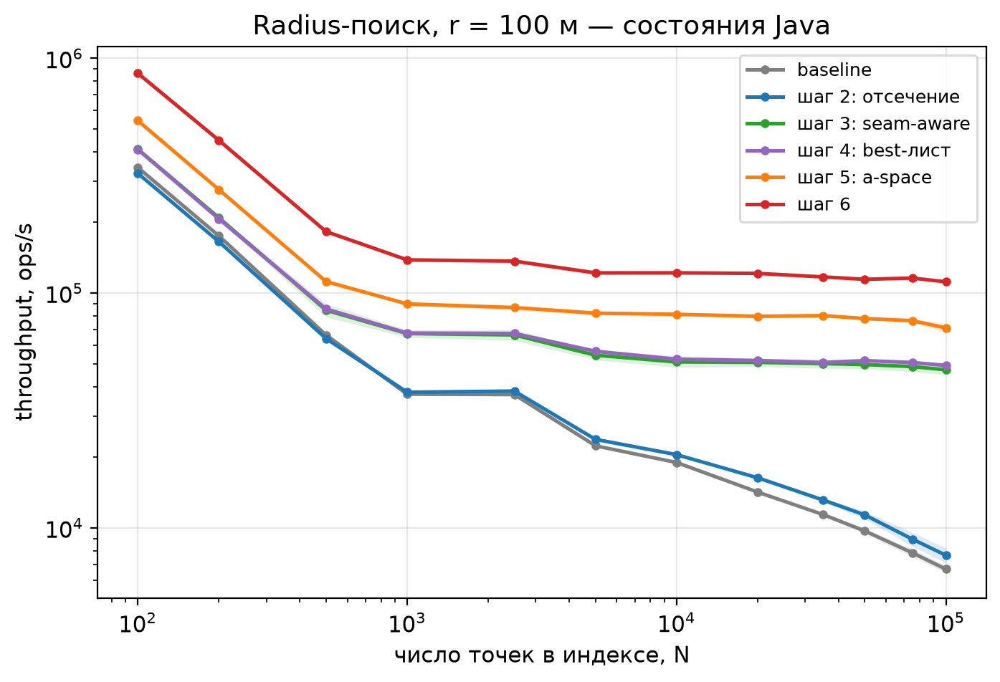
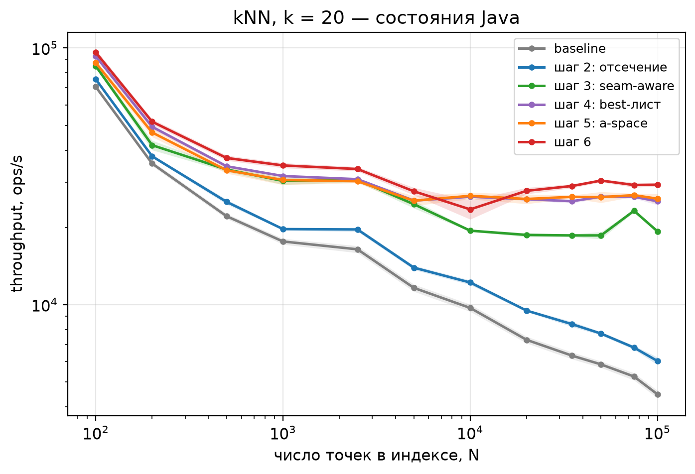
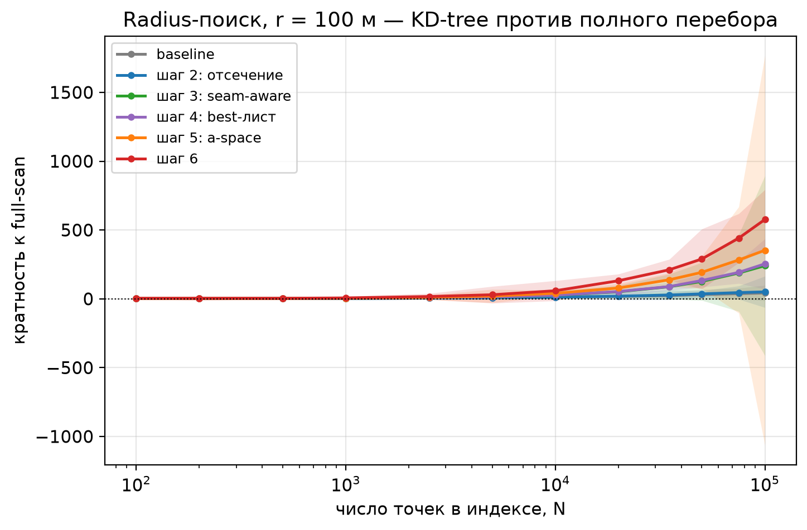
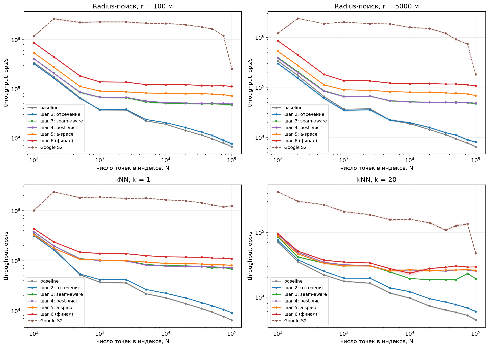
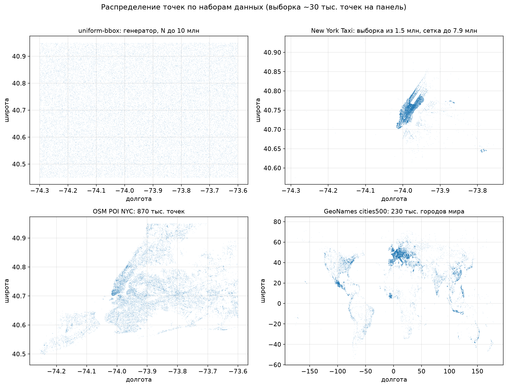
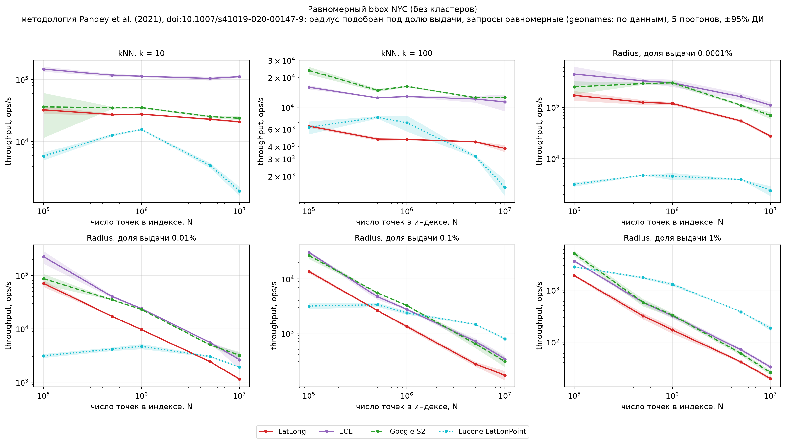
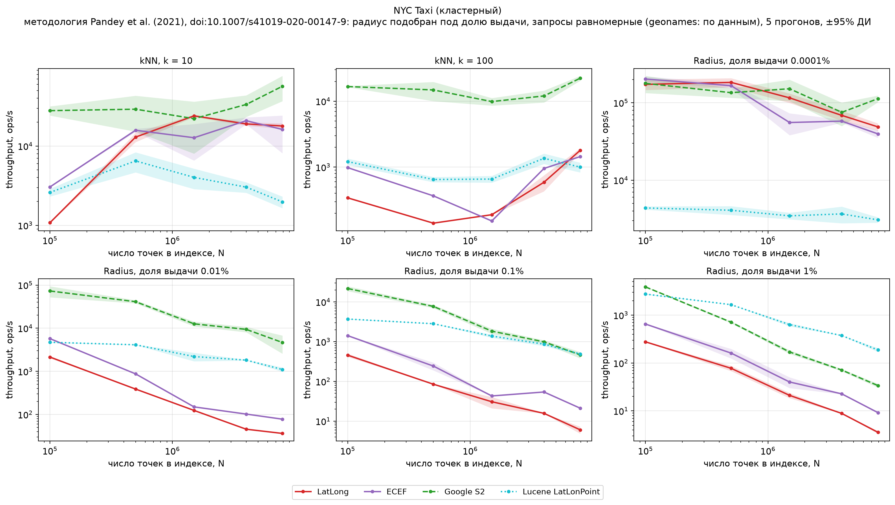
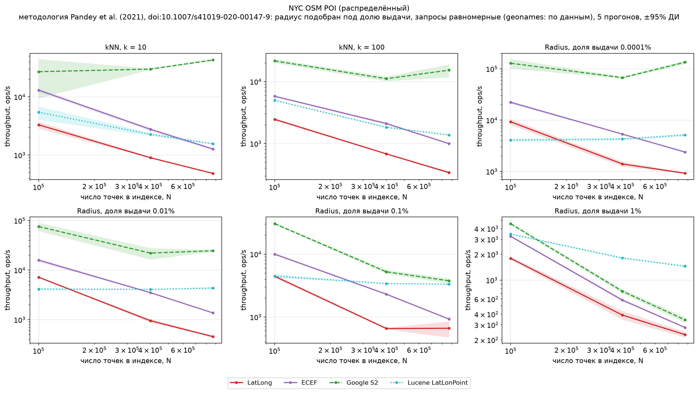
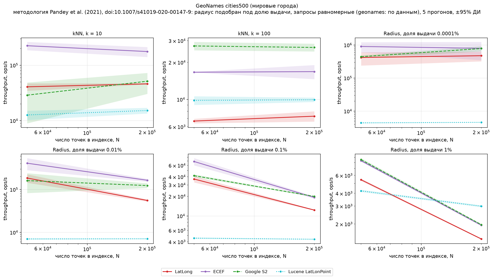
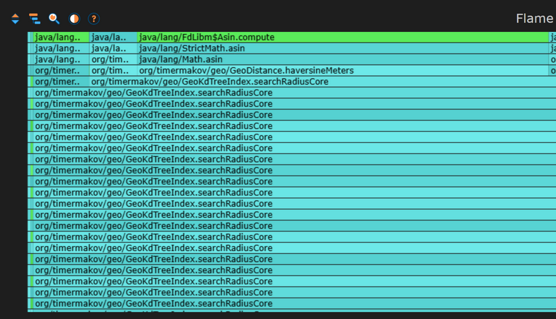

# Отчёт по лабораторной работе: Geo KD-tree — профилирование и оптимизация

## Задание

Реализовать один из изученных на предыдущих курсах алгоритмов или структур данных и выполнить анализ производительности полученного решения, а также серию оптимизаций алгоритма с точки зрения потребления памяти, ресурсов процессора и jit-а.

## Цель

Взять прямой порт C#-реализации KD-tree для геоточек. Довести её до производительности, сопоставимой с промышленными библиотеками. Каждый шаг доказать замерами и профилями.

## Обозначения

- **LatLong**: реализация, работающая непосредственно в координатах широта/долгота (порт C# с оптимизациями шагов 2–6). Историческая ветвь экспериментов.
- **ECEF** (Earth-Centered, Earth-Fixed): действующая реализация. Точки хранятся в землецентрических декартовых координатах.
- **Процент отобранных точек** (селективность): доля данных в выдаче запроса (0.01% = запрос отбирает одну сотую процента точек индекса). Далее по тексту — «доля отбора».
- $R = 6\,371\,000$ м: радиус Земли (сферическая модель, гаверсинусовая метрика).
- $\varphi$: широта, $\lambda$: долгота (в радианах, если не указано иное). $\Delta\varphi$, $\Delta\lambda$: разности между точкой запроса и узлом дерева.
- Единица замеров: операции поиска в секунду (ops/s). Все графики построены с 95%-доверительным интервалом.

## Результаты

1. Выполнен полный цикл оптимизаций: шесть итераций над LatLong-реализацией, затем переход к ECEF с двумя оптимизациями. Каждое состояние сохранено коммитом с замерами и профилями.
2. Построен стенд сравнения по методологии Pandey et al. (2021): четыре набора данных (равномерный bbox Нью-Йорка до 10 млн точек, New York Taxi до 7.9 млн, OpenStreetMap Points Of Interest, GeoNames cities500) и четыре реализации (LatLong, ECEF, Google S2, Apache Lucene). Запросы параметризованы долей отбора, радиус каждого запроса подбирается индивидуально под целевую долю выдачи.
3. Методика доведена до уровня, где цифрам можно верить: калибровка выдачи каждой ячейки (отклонение от цели ~1%), многопрогонные замеры с доверительными интервалами, инкрементальная запись результатов с возобновлением прогона.

## Результаты цикла оптимизаций

### Первая фаза: улучшение KD-tree в LatLong-реализации

Каждый шаг: что не устраивало, какая идея исправляет, эффект.

Базовые значения: throughput, ops/s, N = 100000.

| Шаг | Идея | radius r=100 | kNN k=1 | kNN k=20 |
|---|---|---|---|---|
| baseline (порт C#) | исходный код: расстояние считается для каждой проверяемой точки | 6 678 | 6 447 | 4 475 |
| 2. отсечение по долготе | ветвь за меридианом-сепаратором пропускается, если нижняя граница расстояния до неё больше радиуса | 7 653 | 9 120 | 6 032 |
| 3. граница у шва карты | та же идея, но расстояние считается до ближайшего ребра дуги: меридиана или линии смены дат (+180°/−180° соседствуют) | 47 120 | 69 253 | 19 310 |
| 4. упорядоченный список кандидатов | список лучших k держится отсортированным, новый кандидат вставляется бинарным поиском вместо повторной сортировки | 49 185 | 71 938 | 25 294 |
| 5. сравнение без извлечения корня | порядок точек по расстоянию совпадает с порядком по величине $\sin^2(d/2R)$: сравнения без квадратного корня и обратного синуса; метры только для выдачи | 71 079 | 80 771 | 25 877 |
| 6. предварительное вычисление косинусов при вставке | косинус широты узла хранится в узле, запроса считается один раз на запрос: в обходе остаются два синуса вместо двух синусов и двух косинусов | 111 643 | 109 758 | 29 336 |

**Метрика baseline.** Расстояние считается по гаверсинусовой формуле:

$$a = \sin^2\frac{\Delta\varphi}{2} + \cos\varphi_1\cos\varphi_2\cdot\sin^2\frac{\Delta\lambda}{2}, \qquad d = 2R\cdot\arcsin\sqrt{a}$$

В исходном коде величина $d$ вычислялась целиком для каждой точки листа и каждой проверки ветви. Профиль показал ~94% CPU в `Math.asin` (реализация fdlibm). Больше всего времени занимает полиномиальная аппроксимация обратного синуса, и вызывается она чаще всего. Вывод, определивший весь цикл: ускорять нужно не формулу, а число её вызовов. Дерево нужно отсекать раньше, чем расстояние понадобится.

**Шаг 2. Отсечение по долготе.** KD-tree разделяет точки плоскостью: меридианом или параллелью. До ближайшей точки альтернативной ветви есть аналитическая нижняя граница. Для широтного сплита расстояние до границы равно дуге по меридиану. Её член $a$ выражается без тригонометрии запроса:

$$a_{\text{bound}} = \sin^2\frac{\Delta\varphi}{2}, \qquad \Delta\varphi = |\varphi_{\text{split}} - \varphi_q|$$

Если $a_{\text{bound}} > a_r$, ветвь заведомо пуста и не обходится. Здесь $a_r$ обозначает член $a$ для радиуса запроса. Для долготного сплита аналогичная граница: $R\cdot\arcsin(|\cos\varphi_q|\cdot\sin s)$. Здесь $s$ обозначает угловое расстояние до меридиана-сепаратора. В $a$-форме: $a_{\text{bound}} = \bigl(1-\sqrt{1-x^2}\bigr)/2$ при $x = |\cos\varphi_q|\cdot\sin s$. Обратный синус по-прежнему не нужен. Оговорка: на линии смены дат значения долгот разрывны. Простая граница по $\Delta\lambda$ там ошибочно отсекает близкие точки. Поэтому без запрета отсечения у шва property-тесты ловят пропуски. Эффект шага: +20–26%.

**Шаг 3. Граница у шва карты.** Оговорка шага 2 заменена на точную геометрию. Для долготного сплита расстояние считается до ближайшего ребра дуги: $s = \min(\Delta\lambda,\ 360^\circ-\Delta\lambda)$. Линия смены дат становится вторым кандидатом-сепаратором. Отсечение работает корректно на всём диапазоне долгот, запрет снят. Здесь появляется основной скачок: ×3.5–5.1 к предыдущему состоянию.

**Шаг 4. Упорядоченный список кандидатов.** В kNN-поиске список лучших $k$ при каждом новом кандидате пересортировывался целиком. Это стоит $O(k\log k)$ на принятие. Замена: список постоянно держится отсортированным по убыванию расстояния, худший кандидат стоит первым. Новый элемент вставляется на позицию, найденную бинарным поиском ($O(\log k)$). Бывший худший удаляется. Эффект: +38% в k=20, в radius и k=1 без изменений.

**Шаг 5. Сравнения без извлечения корня.** Функция $d = 2R\cdot\arcsin\sqrt{a}$ строго монотонна по $a$. Поэтому порядок точек по расстоянию совпадает с порядком по величине $a$. Обход и отсечение сравнивают $a$ кандидата с порогом $a_r = \sin^2(r/2R)$ и с худшим элементом списка. Ни $\sqrt{}$, ни $\arcsin$ при этом не вычисляются. Метры достраиваются только для попаданий и принятых кандидатов. Если $a$ кандидата попадает в полосу 8 ulp от порога, кандидат решается точным пересчётом в метры с тай-брейком по идентификатору точки. Это снимает неоднозначность округления на границе радиуса. Эффект: ×1.4–1.5 к шагу 4.

**Шаг 6. Предварительное вычисление косинусов при вставке.** Член $\cos\varphi_1\cos\varphi_2$ зависит от широты узла. Широта узла зафиксирована с момента вставки, поэтому $\cos\varphi_{\text{node}}$ хранится в узле. $\cos\varphi_q$ вычисляется один раз на запрос. В обходе на узел остаются два синуса полуразностей ($\sin(\Delta\varphi/2)$, $\sin(\Delta\lambda/2)$) вместо двух синусов и двух косинусов. Синус полуразности тоже раскладывается по точкам: $\sin\frac{\varphi_q-\varphi_n}{2} = \sin\frac{\varphi_q}{2}\cos\frac{\varphi_n}{2} - \cos\frac{\varphi_q}{2}\sin\frac{\varphi_n}{2}$. Значит, возможно и полное предвычисление обоих членов. Эта линия не опробована, потому что следующий шаг (ECEF) убрал тригонометрию из обхода целиком. Принятый вариант выбран вместо замены обратного синуса на арктангенс. Эксперимент $\arcsin \to \mathrm{atan2}$ дал −5…−12%. Арктангенс на этой JVM сводится к тому же библиотечному коду, но полином длиннее. Вариант отклонён и сохранён с цифрами. Эффект шага: ×1.6–1.7.

Итог фазы: ×16.4–17.0 к baseline для radius и k=1, ×6.6 для k=20. Преимущество растёт с размером данных.

Финал выходит на плато и не замечает роста дерева. Baseline деградирует. На N=100000 индекс быстрее полного перебора в 570–1075 раз.

### Вторая фаза: переход к ECEF и последующие улучшения

LatLong-узел после шага 6 всё ещё тратит десятки наносекунд на два синуса на точку. Дальше три изменения. Замеры сделаны на обновлённой сетке, см. сравнение с библиотеками ниже.

**1. Переход к землецентрическим координатам (ECEF).** Точки переводятся в декартовы координаты на сфере:

$$X = R\cos\varphi\cos\lambda, \qquad Y = R\cos\varphi\sin\lambda, \qquad Z = R\sin\varphi$$

Конверсия выполняется один раз при вставке. Метрика в обходе: квадрат хорды.

$$h^2 = \Delta X^2 + \Delta Y^2 + \Delta Z^2 \quad\text{(три вычитания, три умножения, два сложения на точку)}$$

Хорда монотонна по дуге ($h = 2R\sin(d/2R)$). Поэтому порог радиуса переводится один раз на запрос: $h_r^2 = \bigl(2R\sin(r/2R)\bigr)^2$. Сравнения идут по $h^2$ без корня. Границы отсечения строятся из полупространств. Широтный сплит задаёт плоскость $Z = R\sin\varphi_0$, расстояние до неё считается одним вычитанием. Долготный сплит задаёт двугранный клин через ось $Z$, это две линейные формы. Линия смены дат учитывается второй гранью клина точно, без оговорок. Тригонометрия остаётся только для выдачи результатов в метрах: $d = 2R\cdot\arcsin(h/2R)$ на попадание. Эффект против шага 6: ×2.1–2.9 на сетке, ×2.3–4.2 в многопрогонной сверке (5 fork'ов).

**2. Примитивный буфер кандидатов.** Объектный список лучших $k$ с компаратором заменён на массив примитивов: квадраты хорд и индексы. Худший слот перезаписывается, худший элемент ищется линейным сканом $O(k)$. Сортировок и аллокаций на кандидата нет. Вариант принят после сравнения: сортированный массив с бинарной вставкой проиграл. Двойная перестановка на принятом кандидате давала регресс k=20 на 25%. Эффект: k=20 в 1.2 раза быстрее объектного списка. В многопрогонной сверке k=1 в 2.8 раза быстрее LatLong-реализации.

**3. Балансировка при вставке (scapegoat).** Если доля потомка больше $\alpha = 0.7$ от размера поддерева, поддерево перестраивается медианами по очередной оси. Стоимость вставки при этом амортизируется. Балансировка устраняет единственный известный слом структуры. Без неё на отсортированной загрузке дерево вырождалось в ленту: в 6.9–11 раз больше посещённых узлов на запрос. LatLong-версия в полном прогоне исчерпывает стек уже на 5000 точек. С балансировкой sorted- и перемешанная загрузка не различаются (отношение 0.98). На кластерных данных k=20 ускорился ещё на 30%.

## Сравнение с библиотеками

Методология: Pandey et al. (2021), [doi:10.1007/s41019-020-00147-9](https://link.springer.com/article/10.1007/s41019-020-00147-9). Радиус каждого запроса подбирается индивидуально так, чтобы выдача составляла заданную долю отбора: для запроса $q$ при доле отбора $s$ радиус равен расстоянию до $(s\cdot N)$-го ближайшего соседа. Подбор реализован бисекцией по радиусу с подсчётом через `countRadius` (обход без материализации результатов, ранний выход за пределом $2m$); на скошенных данных, где радиуса «ровно $m$ попаданий» не существует, берётся наибольший радиус с выдачей не больше $2m$. Калибровка каждой ячейки: средняя выдача отклоняется от цели на ~1%.

**uniform-bbox** (100 тыс. – 10 млн точек). Генератор ставит точки равномерно в прямоугольник вокруг Нью-Йорка (40.45–40.95° ш., −74.30…−73.60° д., ~3280 км²), тот же регион, что у taxi. Плотность растёт линейно с N, кластеров нет. Это контрольный набор: разница с taxi читается как чистый эффект кластеризации. Выдача радиуса считается аналитически ($h = N\pi r^2/S$), адаптация радиуса сходится за одну-две итерации. Запросы равномерные по тому же прямоугольнику.

**New York Taxi** (100 тыс. – 7.9 млн точек). Реальные посадки такси (NYC TLC). Распределение бимодальное: ~95% точек на Манхэттене (5.7% площади региона), плотность ядра до ~120 тыс. точек/км² против ~12 точек/км² на воде и окраинах. Особенность протокола: для запроса вне ядра радиуса «ровно $m$ попаданий» не существует — выдача прыгает с нуля до сотен тысяч, поэтому берётся наибольший радиус с выдачей не больше $2m$; медианный радиус на taxi ~10–15 км против ~0.3–5 км на uniform. Запросы равномерные по прямоугольнику — честная «географическая» нагрузка: большинство запросов пустые или малые, редкие тяжёлые.

**OSM POI** (100 – 870 тыс. точек). Точки интереса OpenStreetMap по Нью-Йорку, распределены по городу без выраженного ядра. Протокол тот же, что у taxi; адаптация работает почти как на uniform, средняя выдача близка к цели.

**GeoNames cities500** (50 – 200 тыс. точек). Населённые пункты мира с населением больше 500 человек. Планетарный охват: города у линии смены дат и на высоких широтах, поэтому обработка шва ±180° и полюсов проверяется на реальных данных. Особенность протокола: запросы идут по распределению данных (случайная точка набора плюс дрожание ~1 км), потому что равномерный глобальный прямоугольник дал бы ~70% запросов в океан.

Общий протокол: панели kNN k=10 и k=100 и radius при доле отбора 0.0001%, 0.01%, 0.1%, 1%; 1000 запросов на ячейку (200 при выдаче больше ~20 тыс. точек); один прогревочный прогон и пять измерительных, 95% ДИ по Стьюденту. Реализации: LatLong, ECEF, Google S2, Apache Lucene. Оговорка о контрактах: наши реализации и S2 материализуют результаты, Lucene в radius-панелях только считает попадания (TotalHitCountCollector) — это видно на панелях с долей отбора 1%.

Что видно по режимам:

- **kNN k=10.** ECEF лидирует на uniform (плато ~150 тыс. ops/s до 10 млн) и GeoNames (~300 тыс. ops/s). На taxi и POI впереди S2.
- **kNN k=100.** S2 лидирует на всех наборах (~15–25 тыс. ops/s).
- **Малые выдачи (доля отбора 0.0001%).** ECEF, LatLong и S2 в одной группе (~100 тыс. – 1 млн ops/s в зависимости от набора), Lucene на порядок позади.
- **Средние выдачи на кластерных данных (taxi, доля отбора 0.01–0.1%).** Впереди S2: адаптированные радиусы над разреженными районами велики (медиана ~10 км), и клеточный скан S2 обходит наш обход дерева. На uniform и GeoNames в этом же режиме впереди ECEF.
- **Массовая выдача (доля отбора 1%).** На больших N впереди Lucene: подсчёт без материализации объектов. Наши реализации платят честную цену выдачи в метрах (asin + объект на попадание).
- **LatLong против ECEF.** На больших радиусах стоимость обхода LatLong растёт взрывом (до 193 с на прогон из 1000 запросов при доле отбора 0.1% на 7.9 млн); ECEF в 3–5 раз дешевле за счёт отказа от тригонометрии в узле.

## Профайлинг

Профили сняты tight-loop прогоном без JMH-ожиданий и отрендерены async-profiler. Параметры: n=100000, 30 с.

**Baseline, radius-поиск.** Почти весь профиль занимает одна функция:

~94% CPU в `Math.asin` (fdlibm). Вывод, определивший весь цикл: ускорять нужно не формулу расстояния, а число её вызовов. То есть отсекать дерево.

**Финал, radius-поиск.** Картина принципиально другая:

Обход ECEF (квадрат хорды и полупространственные границы) занимает 52% CPU. Остаток (41%) приходится на `asin` и `sqrt` для точных метров попаданий. Это цена выдачи результата в метрах, а не поиска. Она неустранима без смены контракта выдачи. В kNN LatLong-версии заметную долю занимало обслуживание списка кандидатов. Переход на примитивный буфер снял её: k=20 к списку-объектам ×1.2, в многопрогонной сверке k=1 к LatLong ×2.8.

Flamegraph по каждому состоянию: `report/profiles/grid/*.html`.

## Корректность

На каждом состоянии проходит 84+ теста. Property-тесты сравнивают оптимизированный поиск с эталонным полным перебором по гаверсинусу. Допуск: $10^{-6}$ м на расстояние и совпадение множеств точек. Обе замены метрики на монотонный прокси ($a$-пространство в LatLong, $h^2$ в ECEF) покрыты тестами с учётом пограничной полосы 8 ulp. Кандидат в полосе решается точной метрикой с тай-брейком по идентификатору. Это делает выдачу детерминированной. Отдельные тесты: шов ±180°, полюса, отсортированная загрузка (глубина дерева, оракул выдачи). Метод `countRadius` сверен со `searchRadius` на 300 случайных запросах (совпадение 300/300).

## Выводы

1. Вычисления тригонометрических функций стоили очень дорого. Мы перешли с хранения в структуре данных широты и долготы на точки в XYZ-координатах вокруг центра Земли: вместо синусов сравнение точки стало стоить 8 простых арифметических операций (вычесть, умножить, сложить). Цена узла (3 вычитания, 3 умножения, 2 сложения на точку) стала сопоставима со статическими структурами.
2. Разрыв в производительности нашей динамической структуры данных в сравнении со статическими определяется структурой обхода. Пакетная сборка даёт более плотные границы.
Почему у Smile дерево лучше? Он статический: получает все точки сразу и строит дерево одним разом. Он может отсортировать все точки и провести каждую границу так, чтобы коробка узла плотно облегала свои точки — без пустого места. Мы динамические: точки вставляются по одной, в любой момент, и границы проводятся «на глазок» по текущему состоянию. Коробки получаются рыхлыми: в них много пустоты, поэтому отсечение срабатывает реже и приходится открывать больше узлов.
3. Лидер определяется режимом запроса и данными, абсолютного победителя нет. Наша реализация сильна в kNN при k=10 (плато до 10 млн на равномерных данных, лидерство на GeoNames) и при малых выдачах. S2 силён в k=100 и в радиусных запросах со средней выдачей на кластерных данных. Lucene — в массовой выдаче. Выбор структуры под задачу важнее выбора «самой быстрой» библиотеки.
4. Методика измерений сильно влияет на результат. Селективная параметризация запросов (Pandey et al.) — корректный способ сравнения на скошенных данных: фиксированный радиус на taxi даёт выдачу от нуля до всего датасета и измеряет не поиск, а случайный режим. Одиночные прогоны недооценивали короткие циклы до двух раз — нужны многопрогонные замеры с доверительными интервалами и калибровкой выдачи каждой ячейки.

## Артефакты

- Сырые замеры: `report/bench/grid/` (сетки по состояниям, селективный эксперимент `selectivity-raw-*.csv` и `selectivity-calibration-*.csv`)
- Графики: `report/charts/` (сравнение с библиотеками — `charts/selectivity/`)
- Профили: `report/profiles/grid/` (JFR + flamegraph по каждому состоянию)
- Код: `src/main/java/org/timermakov/geo/`
