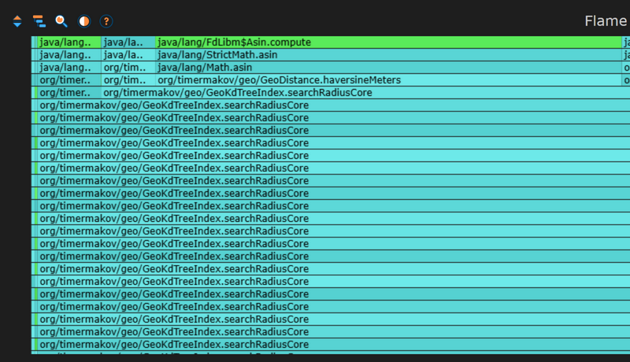
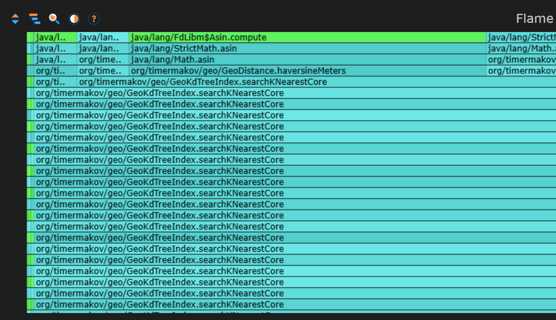

# Baseline-профайлинг Geo KD-tree

Расчёт расстояния съедает почти весь CPU. Функция `Math.asin` занимает 94% сэмплов в radius-поиске и 88% в kNN. Обход дерева при этом не экономится. Поиск в радиусе 100 м идёт по тому же почти полному дереву, что и поиск в радиусе 5000 м. Отсюда план: убрать `asin` из горячего пути, отсекать дальние ветви по долготе и сравнивать кандидатов без `sqrt` и `asin`.

## Как снимали профиль

Профиль снимали утилитой `profile-runner`. Замер шёл в режимах radius и knn при n=100000, каждый прогон длился 30 секунд.

| Режим | Операций за 30 с | Сэмплов CPU | Артефакты |
|---|---|---|---|
| radius (r=1000) | 51 169 | 2835 | [baseline-radius.jfr](report/profiles/baseline-radius.jfr), [.html](report/profiles/baseline-radius.html), [.collapsed](report/profiles/baseline-radius.collapsed) |
| knn (k=20) | 39 937 | 2781 | [baseline-knn.jfr](report/profiles/baseline-knn.jfr), [.html](report/profiles/baseline-knn.html), [.collapsed](report/profiles/baseline-knn.collapsed) |

## Radius-поиск

Самая широкая полоса занимает почти весь профиль. Это `FdLibm$Asin.compute` под `Math.asin`. Цепочка вызовов: рекурсия `searchRadiusCore` вызывает `GeoDistance.haversineMeters`, а тот вызывает `Math.asin` из чисто-Java реализации fdlibm.

- **94,2%** сэмплов в стеке `haversineMeters`. Лист почти у всех сэмплов: `StrictMath.asin`. В HotSpot `asin` не intrinsic, поэтому работает медленная Java-реализация fdlibm.
- **10,6%** сэмплов в `axisLowerBoundMeters`. Для проверки дальней ветви этот метод вызывает ещё один полный haversine.
- `sin` и `cos` в листьях не видны. Это дешёвые JIT-intrinsics, то есть аппаратные инструкции.

Дерево обходится почти целиком при любом радиусе, r=100 и r=5000 дают одинаковые 14,2 тыс. ops/s (таблица ниже). Причина в коде: для longitude-сплитов `axisLowerBoundMeters` возвращает 0.0, поэтому дальнюю ветвь посещают всегда.

## kNN-поиск

Картина та же, плюс два момента:

- **87,9%** сэмплов в стеке `haversineMeters`, `asin`.
- **6,2%** в `tryAddBest`, из них 5,2% приходится на сортировку `TimSort`. Список кандидатов пересортировывается на каждый добавленный узел.
- **3,6%** в `Double.compare`, это сравнение кандидатов.

## Микробенчмарки

Бенчмарк JMH при n=21544 в quick-конфиге (`config/bench.settings.iteration.json`: warmup 10 × 0.5 с, 20 итераций × 0.5 с). Метрика throughput, больше значит лучше ([report/bench/](report/bench)).

| Бенчмарк | Параметр | ops/s |
|---|---|---|
| queryKdTreeRadius | r=100 | 14 184 ± 709 |
| queryKdTreeRadius | r=5000 | 14 198 ± 428 |
| queryFullScanRadius | r=100 | 866 ± 9 |
| queryFullScanRadius | r=5000 | 860 ± 14 |
| queryKdTreeKnn | k=1 | 13 951 ± 539 |
| queryKdTreeKnn | k=20 | 7 737 ± 82 |
| queryFullScanKnn | k=1 | 465 ± 18 |
| queryFullScanKnn | k=20 | 470 ± 15 |

Уже в baseline KD-tree быстрее full-scan в 16–30 раз. Но его скорость почти не зависит от параметров запроса. Так быть не должно: маленький радиус должен проверять в разы меньше узлов.

## Идеи по оптимизациям

1. **asin → atan2.** Заменить `2·asin(√a)` на `2·atan2(√a, √(1−a))`. Формулы математически равны, но `atan2` в HotSpot intrinsic и работает через быстрый libm, а `asin` нет. Лист, который занимает 94% сэмплов, уходит из профиля. Ожидание: ×3–6 на оба поиска.
2. **отсечение по долготе.** Для longitude-сплитов вернуть настоящую нижнюю границу. Это минимальное расстояние от запроса до меридиана: `R·asin(|cos φq·sin Δλ|)`. Любой путь через меридиан не короче этой величины. Тогда радиус 100 м перестанет посещать ~98% дальних ветвей. Ожидание: ×5–20 на radius-поиск и заметный выигрыш в kNN.
3. **сравнение в a-пространстве.** Сравнивать кандидатов по величине `a = sin²(d/2R)` вместо метров. Условие `d ≤ r` превращается в `a ≤ sin²(r/2R)`. Порядок кандидатов по `a` совпадает с порядком по `d`. `sqrt` и тригонометрия остаются только для попаданий и итоговых результатов. Ожидание: ещё ×2–4 на путь сравнения.
4. **kNN без пересортировки.** Держать best-лист отсортированным. Нового кандидата вставлять бинарным поиском вместо полной сортировки на каждый узел. Это снимает ~5–8% kNN-профиля.
5. **предвычисление косинусов.** Хранить `cos(lat)` узла в Node. Считать `cos(queryLat)` один раз на запрос. Это убирает 2 из 4 тригонометрических вызовов на расчёт расстояния. После шагов 1–3 в листьях останется в основном это.
6. **аллокации.** Создавать `GeoSearchResult`-кандидат, только когда он реально попадает в best. Задать начальную ёмкость спискам результатов. Сейчас radius-поиск тратит 153 B/op. Эффект на CPU будет небольшой, но уменьшение аллокаций тоже хорошо.
